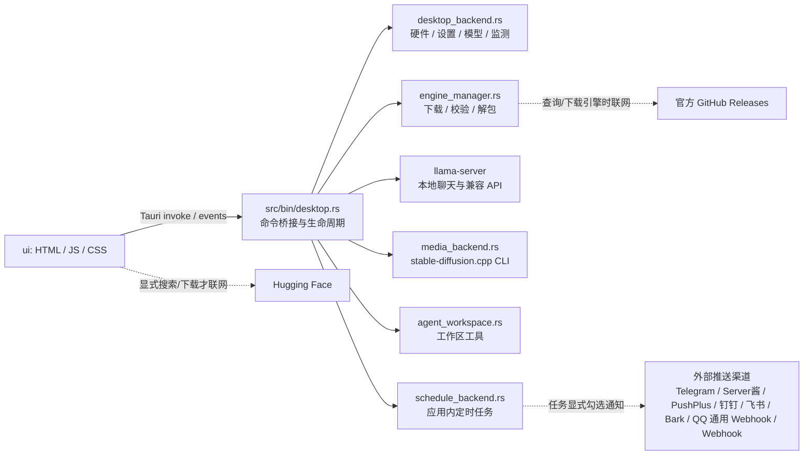

# 本地 AI 工作台：项目结构与技术选型

## 先说结论

仓库不是空白项目：它已经包含可选桌面目标、命令行启动器和多个已接线的本地 AI 工作流。本项目继续采用 **Rust + Tauri 2 + 静态 Vanilla JavaScript/HTML/CSS**，而不是另建 Electron + React 工程。这样可以复用现有 Rust 子进程、模型下载和安全校验逻辑，避免 UI 与后端出现两套引擎管理实现。

桌面窗口本身由 Tauri 提供；推理仍由独立的 `llama-server` 和 `stable-diffusion.cpp` 子进程负责。Tauri/Rust 负责系统集成、本地文件、硬件信息、任务生命周期和命令边界；WebView 前端负责导航、表单、卡片和状态呈现。该选择保留了轻量桌面壳和跨平台方向，但并不意味着各平台均已构建或验证。

## 目录与职责

```text
Cargo.toml                 Rust 依赖与可选 desktop feature
src/
  main.rs                  既有 CLI 入口和旧版配置启动器
  bin/desktop.rs           Tauri 桌面入口、命令注册、运行时/子进程生命周期
  run_config.rs            llama-server 参数能力探测、启动参数和私有 IPv4 绑定策略
  engine_manager.rs        llama.cpp / stable-diffusion.cpp Release 查询、下载、校验、安全解包
  desktop_backend.rs       硬件/磁盘、设置、GGUF、Hugging Face、系统监测等桌面后端
  media_backend.rs         媒体模型下载、stable-diffusion.cpp CLI 生成/取消、输出校验及受限 PNG 预览
  agent_workspace.rs       Agent 工作区文件操作、限额文本搜索与命令执行
  schedule_backend.rs      应用内定时任务持久化、推送适配与执行循环
ui/
  index.html               多页桌面 UI 与侧栏导航
  app.js                   主界面状态、模型/运行/聊天/媒体/定时/设置交互
  agent.js                 Agent 任务流、工具轮次和前端确认面板
  app.css                  全局基础样式
  agent.css                Agent 界面样式
  workbench-theme.css      工作台外观补充
capabilities/              Tauri 权限声明
icons/                     应用图标
.github/workflows/         当前自动化构建工作流
README.md                  使用方式、边界和验证记录
docs/ARCHITECTURE.md       项目架构说明
```

`desktop` Cargo feature 是可选的：默认 `cargo test` / CLI 构建不会要求 Tauri 桌面系统库；桌面开发使用：

```sh
cargo run --features desktop --bin local-engine-manager
```

前端目前是静态原生 JS，没有 React、Tailwind、Vite 或独立 Node 服务。若未来引入前端打包器，应以单一 `ui/` 构建产物供 `tauri.conf.json` 的 `frontendDist` 使用，不要复制 Rust 命令或模型下载逻辑。

## 核心数据流



聊天服务默认只监听回环地址；新配置的默认 API 端口为 `8666`。用户已保存的端口不会因更新被覆盖。局域网访问默认关闭，开启后才尝试绑定操作系统选出的私有 IPv4 地址。Tauri 页面与本地模型服务是两部分：前者提供界面，后者提供 `llama-server` 的 `/v1` 兼容接口。

## 本机数据与联网边界

| 数据/操作 | 当前实现位置 | 边界 |
| --- | --- | --- |
| 应用设置 | 应用数据目录 `settings.json` | 模型目录、作品目录、外观、有限英语界面、API 端口；已有设置原样读取 |
| 对话历史 | 应用数据目录 `chat-sessions.json`；失败时前端可回退 WebView 存储 | 不发送到 Hugging Face；只有发给本机运行的模型服务 |
| 模型权重 | 用户选择的模型目录，媒体组件放在其 `media/` 子目录 | 公开 Hugging Face 搜索/下载需要联网并由用户显式操作 |
| 生成作品 | 应用默认或用户选择的作品目录，分为 `images/`、`videos/` | PNG 作品提供只读索引与目录内预览；真实模型生成尚未验证 |
| 应用版本检查 | 设置页只读查询公开 GitHub Releases | 只展示版本与发行说明，不自动下载或安装 |
| 定时任务 | 应用数据目录 `scheduled-tasks.json` | 支持一次、每小时、每天、每周和 1–525600 分钟固定间隔；应用保持运行且本地模型运行时才执行，关闭时错过的任务跳过；单次模型请求最多 30 分钟、响应体不超过 1 MiB；通知凭据只在进程内存，退出后清空 |
| Agent 任务记录 | WebView 本地存储 | Agent 文件操作检查工作区路径；子进程仍以当前用户权限运行 |
| 引擎版本 | 用户数据目录的独立版本文件夹 | GitHub 官方 Release 查询/下载需要联网；安装包会做 SHA-256 校验和安全解包 |

**安全限制：** Agent 的命令、覆盖、edit_file 和删除在 Rust 后端的操作边界会弹出系统原生 Yes/No 确认；前端确认卡只是操作预览，直接调用危险工具也不能绕过系统确认。命令仍以当前用户权限执行、继承进程环境，并可能访问工作区外文件或网络；工作目录设在工作区并不能限制其权限。这不是操作系统进程沙箱，也不应描述为隔离执行环境。

## 当前能力对照

| 模块 | 已接线的能力 | 仍未实现或未验证 |
| --- | --- | --- |
| 概览/硬件 | CPU 型号及物理/逻辑核心数、系统内存总量/可用量、模型盘容量/余量；NVIDIA-SMI 和支持的 Linux DRM 设备可提供 GPU 显存总量/已用；Windows WMI 可读取设备名称；按系统内存显示保守模型规模档位 | 其他 GPU 来源的显存数据可能未知；GPU 推理参数未接线且当前引擎为 CPU 变体；模型档位仅供初筛，不保证适配或速度 |
| 引擎/模型 | 两个引擎独立管理；GGUF 导入与公开 HF 搜索/下载；媒体权重下载 | GPU 版自动选择、Safetensors 转 GGUF/量化、分片 GGUF 编排 |
| 运行/对话 | 启停本地 llama-server、上下文/部分参数能力探测、多轮 SSE 流式聊天、文本附件、历史保存（Agent/定时任务仍是完整响应） | 实测 tok/s、图片/PDF 附件、代码文件导出、强制思考开关 |
| 图像/视频 | 文生图和固定 33 帧 Wan 文生视频命令接线；取消、输出校验、PNG 作品预览/只读索引 | 图生图、生成进度、视频预览；没有用真实权重验证生成兼容性 |
| Agent | 本机模型工具轮次；工作区内列目录、读取、创建空文件夹、写入新文件、以唯一精确文本片段原子编辑既有文件，以及有上限的只读文本搜索；edit_file、命令、覆盖、删除均经过应用审批及后端系统原生确认 | 与 LocModel 不完全等价；未实现 MCP、网页/浏览器工具或电脑操作；没有操作系统级进程沙箱，命令仍以当前用户权限访问资源 |
| 定时/监测 | 应用内一次/小时/日/周/自定义间隔任务；可选的 Telegram、Server 酱、PushPlus、钉钉、飞书、Bark 与通用 Webhook 发送适配器；CPU/内存/模型进程采样、最多自动重启 3 次并采用递增间隔 | 操作系统后台任务与系统通知；真实推送端点/送达未实测；QQ 仅支持通用 JSON Webhook，不是官方直连；完整持续守护 |
| 设置/平台 | 中文及有限英语界面（导航、设置、版本检查）、模型/作品目录、外观、API 端口、公开 Release 版本检查、Tauri 桌面入口、Windows x64 NSIS 安装包 | 完整多语言翻译、用户自定义品牌名设置、macOS 自动引擎安装、Linux `.deb`/AppImage、Windows MSI 及全平台真机验证 |

## 建议的后续实现顺序

1. **硬件与模型规划：** 明确支持的 GPU 后端及平台，再把已核实的显存/设备能力接入实际启动参数；保留未知状态，不猜测 tok/s 或内存需求。
2. **模型与聊天：** 增加可取消的 Safetensors 转换/量化流程、分片 GGUF 管理，以及实测 tok/s 速度统计；API 默认继续限制回环地址。
3. **媒体体验：** 增加生成进度、视频预览和图像参考输入；每个能力先核对上游 CLI 参数和模型兼容要求。
4. **Agent 安全：** 为命令增加可配置程序/参数策略，补充工作区外操作的显式授权；评估独立进程沙箱后再引入 MCP。
5. **自动化与发布：** 补充系统通知、验证并完善推送适配、加强调度去重，再补桌面 feature 的 Windows/Linux CI、真实桌面启动检查和正式打包。

应用内品牌当前固定写在 `tauri.conf.json` 和 UI 文案中；用户可在构建层修改产品名，但“设置页自定义名称”尚未实现。界面提供中文与有限英语切换，英语目前只覆盖导航、设置页和版本检查区，完整多语言资源尚未接入。
